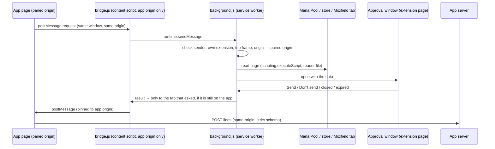

# Browser companion — threat model and security design

Status: built (beta, internal `companion` flag). Code: `extension/` (Manifest V3, plain JavaScript,
no dependencies, no build step), app side `web/src/core/companion.ts` + `web/src/app/useCompanion.ts`,
server side `src/magic_manager/api/companion.py` + `companion.py`. Decisions: architecture doc §25
H12/H13. Owner requirement (2026-10-07, verbatim): *"we should also be very aware of security
concerns users may have and develop in a way that we cannot be used by a malicious actor to harm
our users."*

## What it does, in one paragraph

The app asks the companion to read something only the user's own browser can see: their Mana Pool
cart page, their open store tabs, or a Moxfield deck. The companion reads it locally and opens **its
own approval window** that shows exactly what would be sent. Only when the user presses **Send**
does it hand those lines to the app tab that asked. The app then posts them to its own server, like
any other request. No credential, cookie, session token, email or address ever leaves the browser.
The server never sees a Mana Pool login.

## Assets

1. The user's marketplace accounts (Mana Pool, Moxfield, stores): passwords, session cookies/tokens,
   addresses, payment details, order history.
2. The user's collection data in the app (writes must come from the user).
3. The integrity of what the app believes is in a cart or deck.

## Attackers and how each is stopped

### 1. A malicious website that tries to talk to the extension or the app

| Attack | Defence | Pinned by |
|---|---|---|
| A page calls the extension directly | No `externally_connectable`: no web page can reach the worker. | `test_manifest_asks_for_the_least` |
| A page posts our message format | The bridge is registered only for the **paired origin**. It re-checks `location.origin` against the stored pairing and ignores everything else. On other sites (or another port on localhost) nothing answers and no window opens. | `companion-extension.spec.ts` (other site, other port) |
| A forged message reaches the worker | The worker checks `sender.id`, `sender.frameId === 0`, `sender.origin === paired origin` **and** the tab's current URL. Extension-page messages are accepted only from the extension's own origin. | same + code review |
| An iframe on the app page | The bridge runs top-frame only (`allFrames: false`, `window.top === window`), and the worker requires `frameId 0`. | code |
| Approval-window spam | One pending request at a time (`request.busy`), focus goes to the open window, 5-minute expiry, closing counts as no. | `companion-extension.spec.ts` (busy, close) |
| Clickjacking / keystroke-jacking the approval | The window is the extension's own page and can't be framed (no `web_accessible_resources`, CSP `frame-ancestors 'none'`). "Don't send" has focus and "Send" is disabled for the first second, like Chrome's permission prompts. | `companion-extension.spec.ts` (focus) |
| Cross-site writes to the app's API (CSRF) | **App-wide:** every non-GET `/api/` request whose browser `Sec-Fetch-Site` is not `same-origin`/`none` is refused with `request.cross_site`. That covers other sites and other localhost ports. JSON bodies need a CORS preflight the server never grants. | `test_writes_only_from_the_apps_own_pages` |
| Smuggling extra fields to the server | The companion endpoints use strict Pydantic models (`extra="forbid"`) with size caps. A body carrying `cookie`/`session`/unknown fields is a 422. | `test_cart_lines_route_audits_and_refuses_extras`, `test_cart_reader_output_is_exactly_what_the_server_accepts` |

### 2. A compromised or spoofed app server (or someone impersonating our app)

- **Pinned, user-confirmed origin.** The user types the app address on the extension's settings page
  and Chrome asks them to allow it. Nothing on a web page can set it. Allowed: `http://localhost`,
  `http://127.0.0.1`, or `https://*.ts.net` (Tailscale) in this build. Plain http is refused for
  anything but this computer. Addresses with a path or credentials are refused (`parseAppOrigin`,
  pinned by the extension e2e).
- **Data minimisation.** Even a malicious paired app can only receive what the readers produce, after
  the user approves it:
  - cart: card name, printing id (Scryfall id from the image link), set name, finish, condition,
    treatments, quantity and unit price. No seller, address, totals, account or Mana Pool ids.
  - TCGplayer / Card Kingdom carts (extension 0.3.0): per line its kind (single / sealed), the store's
    product id (TCGplayer: from the product link; Card Kingdom: from the card image), card name (the
    catalog name — never a seller's own listing title), set name / edition, collector number as shown,
    finish, condition / grade, language, quantity and unit price. Never the sellers, shipping, totals,
    saved-for-later items, the sign-in form, Card Kingdom's request token or line-item ids (the
    reader e2e asserts seller names, the token and totals are absent).
  - tabs: URL and title of open tabs on the Deals stores. For open-tab stores also the page title,
    whitelisted price/stock meta tags, schema.org Product JSON-LD, and visible lines that mention a
    price or stock, plus the main offer's short (≤ 80 characters) "Sold by" / "Ships from" /
    "Shipper / Seller" / "Condition" lines and the seller or condition right after a bare label
    (added 2026-10-10 so marketplaces count only the store's own new offers). The store-page fixture
    plants a name, an address and a CSRF token — and a long personal line right after a "Condition"
    label — and the test asserts none are read.
  - order history (Mana Pool, TCGplayer, Card Kingdom): per order its number, date, and the
    store's subtotal / shipping / tax / fees / store credit / total; per line the item name, set
    name, printing (Scryfall id or TCGplayer product id, set code + number), finish, condition,
    quantity and unit price. Never the shipping/billing name or address, payment card, tracking,
    sellers, e-mail, the page's request token or Card Kingdom's embedded per-order JSON (payment
    data) — the readers read table cells only and the fixtures plant those fields to assert they're
    dropped. The store page links the companion follows stay in the worker; they aren't sent.
  - Moxfield: deck name, author user name, and per card: printing, quantity, finish and board.
    Profile, likes, prices and internal ids are dropped (pinned).
  - Archidekt deck (extension 0.4.0): deck id, name, owner user name, and per card: printing (Scryfall
    id, set code, collector number), name, quantity, finish (modifier) and categories. The page's
    embedded data also carries your IP address, avatar, prices and Archidekt's internal ids — the
    fixture plants an IP and a fake session string and the test asserts none are read.
  - Moxfield collection / binder (extension 0.4.0): per printing × finish the Scryfall id, set code,
    collector number, name, quantity, finish, and `proxy` / `digital` flags (so the app can skip them).
    Plus the read's scope, share id and binder name. Never condition, language, purchase price, notes,
    dates, your profile or Moxfield's ids (fixture plants a personal note; pinned).
  - watched store pages (Deals → Watching, added 2026-10-10, extension 0.2.1): for each watched link
    the URL, store name and whether it was your open tab, plus exactly the open-tab page reading above
    (the same `readers/store-page.js`). Nothing about any other tab.
- **The user sees exactly what is sent**: a table plus the raw JSON, before anything leaves.
- **Read-only to every site.** No cart edits, purchases or writes, and no form submission.
- **Watched pages: the list is approved before any tab opens.** The app sends watched URLs; the worker
  keeps only https product pages of a catalogued `rendered` store (host + the store's product-URL regex,
  no credentials/port, ≤ 50 — re-checked in `watched.js`, the app's list is never trusted) and shows that
  list first (stage `confirm`). Only *Read these pages* (a `decision` of `'read'`, accepted only in that
  stage) opens anything; a `Send` (`approve: true`) is refused in any stage but `send`, so the plan can
  never be delivered as data. Pages not open are opened **inactive**, at most 3 at a time, and closed in a
  `finally` (also on load timeout or error); tabs you had open are never closed, and one is read only if
  it still shows that exact page. *Don't read* / closing the window mid-read stops opening more pages.
  Then the readings are shown and need *Send* as usual. Pinned by `companion-watched.spec.ts`.
  Security review (2026-10-10): no findings; its two below-threshold notes (reads continuing after
  *Don't read*, a tab navigated away mid-read) were fixed as above.

### 3. Supply chain / extension update

- **Minimal permissions**: `scripting` + `storage` only. Install-time host access is
  `https://manapool.com/*` only: the cart page, **not** its `sb-api` host. Everything else is
  **optional** and asked for when the user switches a feature on:
  - the paired app address,
  - **Deals**: the 21 store sites from `config/vendors.toml` (generated into the manifest; CI fails
    when stale). Amazon, Walmart and GameStop were added 2026-10-10 (extension 0.1.1): Chrome asks
    for the whole store set, so a user who had Deals on switches it on again once to grant them,
  - **Moxfield**: `moxfield.com` + subdomains (decks, collection and binders).
  - **Archidekt** (0.4.0): `archidekt.com` + `www.archidekt.com`.
  - **Order history**: `store.tcgplayer.com` + `www.cardkingdom.com` (Mana Pool order pages are on
    the install-time `manapool.com`).
  - **TCGplayer cart**: `www.tcgplayer.com`; **Card Kingdom cart**: `www.cardkingdom.com` — one switch
    per store (owner, 2026-10-10). Switching one off keeps a site another switched-on feature still
    needs (Card Kingdom's host is shared with Order history and Deals).
  No `<all_urls>`, `tabs`, `cookies`, `webRequest`, `history`, `debugger`, `nativeMessaging`
  (all asserted absent).
- **No remote code**: no `eval`/`new Function`/`importScripts`/`innerHTML`, no remote URLs beyond the
  three sites, and a strict extension-page CSP (`script-src 'self'; object-src 'none'; base-uri 'none'`).
  The test scans every file.
- **No dependencies, no build step.** The source in `extension/` *is* the extension. The zip the app
  serves is **byte-for-byte reproducible** (sorted entries, fixed timestamps), so a download can be
  compared to the repo (`test_zip_is_reproducible_and_ships_only_the_extension`).
- **No auto-update channel.** Beta installs are unpacked. Updating is a deliberate re-download (the
  app shows "update available" by comparing versions). Store distribution is a later decision.

### 4. Data misuse / overreach

- Reads happen **only** when the app asks and the user then presses Send. There's no background
  collection or polling. The **extension** sends no analytics. The **app** reports only a failure's
  catalogued code as `companion.error {code}` (`config/analytics_events.toml`, the enum is exactly
  `extension/errors.json`), under the user's analytics consent. Never any cart, tab or deck content.
- Storage: the paired origin (`storage.local`), plus the one pending request in `storage.session`
  (memory only, not readable by content scripts, cleared on decision).
- Tabs the companion opens itself (a cart, deck, order-history or watched store page, in the background) are closed
  afterwards. Order reads always open their own tab (never navigate one of yours), follow only the
  store's own same-origin page links, press only Mana Pool's "Item List" view tab, and never submit
  a form (TCGplayer's year filter is a form, so you pick the year on the page yourself).
  Your own open tabs are left alone.

### 5. The bookmarklet fallback

It runs in the user's Mana Pool page, so the same rules apply. It is **the extension's cart reader
verbatim** plus a few lines that copy the result to the clipboard
(`test_bookmarklet_is_the_extension_reader_verbatim`). It makes no network call and reads no cookies
or storage. The user pastes it into the app themselves. The app validates the paste with the same
schema (`parseBookmarkletPaste`) and the server's strict model.

## Residual risks (accepted, documented)

- **A compromised machine or browser** defeats any extension. Out of scope.
- **XSS in the paired app** could trigger requests. Each still needs the user's Send in the
  extension's window, which names the asking origin and shows the data.
- **Store page text lines** are filtered to lines mentioning a price or stock, so a personal line that
  also contains a price (e.g. "Jared's cart: $0.00") could be included. The same holds for a short
  line that starts like an offer label ("Sold by …", "Condition …") or follows a bare one. Both are
  shown in the approval window before sending.
- **DNS rebinding** against a localhost app (a hostile domain resolving to 127.0.0.1) isn't stopped by
  `Sec-Fetch-Site`. Mitigation belongs with hosted auth (Phase 3, H4: a Host allowlist plus session
  cookies). The companion itself is unaffected, because it pairs by exact origin.
- **Archidekt private decks** are read from the deck page the user's own signed-in browser loads. The
  browser attaches its own cookies, and the companion never reads them.

## Moxfield sign-in token — the one exception (owner-approved, 2026-10-11)

Moxfield's private data (your collection, your binder list, private decks, binders and collection links)
is served only with a short-lived bearer token. Moxfield's page keeps it in memory and gets it from
`POST https://api2.moxfield.com/v1/account/token/refresh` using the browser's own `refresh_token`
cookie. The owner chose to support private reads anyway (*"Both — share link now, plus private via
Moxfield's sign-in token (security exception)"*). The design keeps the exception as narrow as possible:

- **Only when needed.** Share links and public decks are read anonymously. The reader asks for a token
  only for your own collection / binder list, or after Moxfield answers *private* to an anonymous request
  (`moxfield-api.js`).
- **Minted, not read.** It never reads cookies, storage or Moxfield's page state. It makes the same
  refresh call moxfield.com makes; the browser attaches the cookie. A token string over 8 KB is ignored.
- **Lives in one closure, for one read.** It is held in a local variable of `moxfieldSession()` in the
  injected reader (the extension's isolated world). It is sent only as `Authorization: Bearer` to
  `api2.moxfield.com` — the only host the helper calls — and is never returned, stored, logged or sent
  to the app or the approval window. The e2e asserts the token string is absent from every result.
- **Read-only.** Only GETs (plus the refresh POST itself). No Moxfield write endpoint is called.
- **Residual:** the refresh call can rotate Moxfield's refresh cookie (the browser stores the new one,
  as on moxfield.com). A compromised reader file could misuse the token — the same trust as the
  extension's code, mitigated by no remote code, a reproducible zip and code review.

## Security review (2026-10-11, Archidekt decks + Moxfield collection / binders, extension 0.4.0)

SECURITY_REVIEW_PLACEHOLDER

## Security review (2026-10-10, TCGplayer + Card Kingdom carts, extension 0.3.0)

The security-review agent reviewed the diff: **no findings.** Checked: the Scryfall name search built
from a cart line (argument list, URL-encoded by the wrapper, fixed host), store selection
(`Object.hasOwn` against the fixed `CART_STORES` table — reader file, function, URL, tab patterns and
origins all come from it; the call runs in the extension's isolated world), hostile cart-page text
(rendered as text only; strict server models with a character whitelist on `number`; bound SQL),
data sent (only the documented line fields), and permissions (one new opt-in host, `www.tcgplayer.com`;
switching off keeps sites another feature needs; the bookmarklet stays Mana Pool only server-side).

## Security review (2026-10-07)

The security-review agent reviewed the finished diff: **no exploitable findings.** Message authentication,
the approval window, pairing, readers, strict endpoints, the write guard, the bookmarklet and the
web protocol client were all assessed as sound. One pre-existing, below-threshold note was deferred
to hosting/auth (H4) by the owner: no Host-header allowlist, so DNS rebinding against a localhost
API isn't blocked (see Residual risks). The pinned tests then caught and fixed two real bugs before
merge:
- The approval window is itself a tab, so its decision was mis-routed as an app request and read as
  "expired". The worker now routes the extension's own pages first.
- "Don't send" could be clicked before its handler loaded. Both buttons now start disabled.
